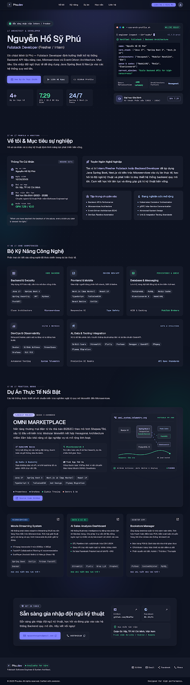

# 🌌 Nguyen Ho Sy Phu - Obsidian Portfolio

> Modern, high-performance software engineering & full-stack developer portfolio with ambient interactive visual effects.



---

## 🚀 Live Demo & Deployment

- **GitHub Repository**: [NhsPhu/Profolio](https://github.com/NhsPhu/Profolio)
- **GitHub Pages**: [https://nhsphu.github.io/Profolio/](https://nhsphu.github.io/Profolio/) *(Bật trong Settings > Pages > Deploy from branch `main`)*

---

## 🛠️ Tech Stack & Highlights

- **Core**: Vanilla HTML5, Modern ECMAScript, Canvas API.
- **Styling**: Tailwind CSS CDN, Custom Design System (`Obsidian Engineering` tokens).
- **Typography**: Geist Sans & JetBrains Mono (Google Fonts).
- **Interactive FX**:
  - Dynamic interactive particle mesh background on Canvas.
  - Custom fluid cursor glow & spotlight hover states.
  - Ambient floating aurora glowing orbs with CSS keyframe interpolation.
  - Interactive Project & Tech Stack showcase cards.

---

## 📁 Cấu trúc thư mục

```text
Profolio/
├── index.html        # Entry point cho GitHub Pages / web servers
├── code.html         # Bản gốc mã nguồn trang Portfolio
├── DESIGN.md         # Quy chuẩn hệ thống thiết kế (Tokens, Colors, Spacing)
├── screen.png        # Ảnh chụp giao diện thực tế
├── README.md         # Tài liệu dự án
└── .gitignore        # Danh sách file loại trừ
```

---

## ⚙️ Hướng dẫn kích hoạt GitHub Pages

1. Truy cập vào **[Settings](https://github.com/NhsPhu/Profolio/settings)** của repository `NhsPhu/Profolio`.
2. Vào mục **Pages** ở thanh menu bên trái.
3. Ở phần **Branch**, chọn nhánh **`main`** và thư mục **`/ (root)`**, sau đó nhấn **Save**.
4. Chờ 1–2 phút, website của bạn sẽ hoạt động trực tiếp tại địa chỉ:  
   👉 **`https://nhsphu.github.io/Profolio/`**
